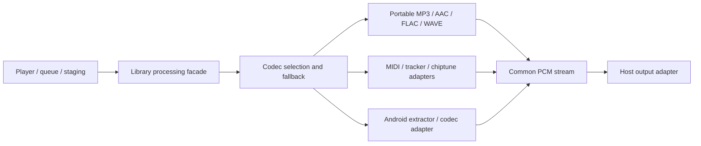

# Parsing, decoding and output boundaries

## Shared stream architecture

libinfinistream is the platform-neutral transport/metadata foundation for the library family. StreamAudioInput adapts its known-length positional SourceResources, PcmStreamHandle exposes actual typed PCM metadata, and AudioStreamProcessor declares encoded/PCM ports and pull ownership. FileAudioInput uses the shared positional implementation while retaining legacy file hints. Store opens resources; Vault is used only for containers; Sound consumes their sources without depending on either implementation or the application. Existing AudioInput/PcmStream APIs remain available during migration. JVM contracts do not imply native iOS binaries.

Updated 2026-10-30 for the portable codec and Android adapter increment.

`audio-api` contains contracts, models and existing playlist/CUE/CDDB parsing. `audio-core` is a JVM library containing portable implementations and `AudioFileProcessor`; it has no dependency on an Android SDK, Activity, player service, storage runtime, output device or Cast service. `audio-processing` is the Android composition and native tracker packaging module. It depends on the core, and registers Android's extractor/codec adapter inside the library.

## Input and stream contracts

`AudioInput` is reopenable and creates independent closeable `AudioBytes` random-access handles. Codecs own the handles they open. `FileAudioInput` and `MemoryAudioInput` are JVM conveniences; the host retains staging/cache leases until their streams or preparations finish.

`PcmDecoder` opens a `PcmStream` with format metadata. Reads return complete interleaved frames, left-aligned in signed 32-bit integer samples; the format records sample precision. EOF is -1. An all-zero block is valid audio. Backend objects and platform media handles do not cross the contract.

`AudioFileProcessor` selects codecs with explicit `PLATFORM_FIRST`, `PORTABLE_FIRST` or `PORTABLE_ONLY` policy. Existing specialized/composite formats keep their previous rendering priority. Standard formats can use either Android decoding or a portable implementation. A streaming open can fail during consumption and callers must close it; it cannot silently switch codecs after samples have already reached an output device.

Prepared-file decoding can recover from a later codec error: it closes the failed decoder, discards partial PCM and restarts another codec at source position zero. The destination is a host-owned staging file and must differ from the source. Cancellation closes handles and discards partial output. Successful preparation reports the selected decoder, exact PCM duration and streaming health metrics.

## Portable codecs

MP3/Layer II synthesis is translated from JLayer. Our Xing/Info/LAME reader supplies musical frame counts and encoder/synthesis delay trimming where metadata is available. AAC uses our ADTS and ISO-BMFF box/sample-table readers with JAAD synthesis. Supported edit lists trim AAC delay and padding; encrypted tracks and complex edits are rejected so another backend can handle them. FLAC's parser validates frame/header CRCs and reconstructs constant, verbatim, fixed and LPC subframes, Rice/escape residuals, wasted bits and stereo decorrelation. High-resolution FLAC is retained through 32-bit samples. WAVE PCM/float input is read in blocks.

The old `AudioProcessor.decode` returns an in-memory 16-bit `AudioPcmData` compatibility result. It uses the same backend selection inside the Android composition, including platform fallback. Streaming and prepared-file APIs preserve higher precision and do not allocate a whole track's PCM in memory. Existing MIDI/tracker/soundbank renderers retain their buffered synthesis behavior and caps through a compatibility adapter.

## Android and player integration

`AndroidPcmDecoder` owns MediaExtractor, MediaDataSource and MediaCodec. It translates Android PCM encodings, releases the decoder on failure/close, and applies encoder delay/padding once to the resulting samples. If a platform codec reduces FLAC source precision, preparation can fall back to the portable decoder. Android metadata and position-following analysis remain separate library adapters.

InfiniFolder retains player service state, source staging and leases, output routing, focus, speed, seeking, repeat/shuffle, CUE source ranges, queue/preload/handoff, visualization presentation and Cast. Its main and preload paths now obtain AudioWaveSource from the library; MediaPlayer is given only that canonical PCM ByteSource. Visualizer analysis borrows independent views of the same resource. Duration discovery uses the library, without constructing a player to parse the original source. The diagnostic facade connects per-request preparation/decode events to the existing playback report; preloading suppresses those events.

Cast conversion now requests explicit `PcmOutputOptions` through the same library
source/cache path. Packing precision and mono duplication are bounded processing
inside the core; actual output metadata reports the resulting format. Receiver
selection, HTTP ranges/backpressure, concurrent borrowed views and resource/cache
leases remain in the application. Existing source rate and surround-channel
policy are retained, and default local playback does not request this conversion.

For exact-length decoded streams, PcmWaveSource serializes a WAVE header and one initial PCM block, then pulls subsequent PCM into an explicit host-owned disk cache as requested. Optional FrameSeekablePcmStream decoders fill independent 4096-frame blocks; other decoders retain prefix decoding. Its positional reads are serialized and do not change independent sequential cursors. Backward access reuses valid cache blocks; forward access uses the decoder's exact output-frame timeline where supported. The Android standard backend and portable MPEG/FLAC/WAVE decoders provide that capability. MP3 uses an exact header-only packet index and bounded preroll to preserve decoder/encoder delay alignment. The index is built lazily and retains at most 4096 coarse anchors. Unknown decoded lengths keep complete preparation. The original prepared-file API and all codec implementations remain available. Late decode/seek failures are reported and retry full preparation under the same negotiated PCM format; cancellation never retries. No unavailable cache holes are exposed as zeros or EOF. Finished signal diagnostics require validation of every block exactly once.

Portable MPEG decoding uses a bounded owned byte view which hides a trailing ID3v1 tag from JLayer, including after indexed restarts. The original source remains intact for metadata readers. Only three bytes at the footer marker are probed; tag bytes are never passed to packet look-ahead. Encoder trim, exact frame counts and synthesis are unchanged. This prevents a lost final packet from provoking the expensive full-preparation recovery path.

MediaPlayer's linked gapless players remain the output mechanism, using the existing host MediaDataSource adapter over library-decoded PCM. MediaPlayer prefetch can still request several megabytes during seeking. AudioProcessing.openPlaybackSource therefore prefers the existing portable MPEG implementation for content with validated MPEG timing: in the recorded device benchmark it decoded a two-minute track about 13 times faster than the Android adapter. Android fallback remains registered in the library. Other formats retain platform-first policy; explicit/openWaveSource policy APIs remain available. Android PCM conversion uses bulk buffer reads and codec input/output queues avoid blocking on input when output is available. Processing is bounded in memory; the decoded cache can grow to the full track. Encoded staging remains explicit for unsupported/sequential and legacy companion-file inputs, CUE slices, and archive adapters which extract complete entries. RIFF output over 4 GiB is rejected explicitly. Device gapless/interruption/route checks remain necessary; source and format tests alone cannot validate hardware playback.

## Portability

The portable API/core build and tests exclude the Android module with `-PportableOnly=true`. Linux, Windows and macOS JVM hosts can use that core and provide their own output. Native iOS/macOS integration requires common/native contracts, native codec adapters and toolchain-specific packaging; this increment does not claim those binaries exist. See the [portability roadmap](portability-roadmap.md).

## Native ownership and notices

Tracker JNI sources/build task/load names remain in `audio-processing`; the bridge's JVM class moves with the portable core and retains its JNI class name. Android consumer rules preserve the linkage. Existing Termux packaging and Kotlin fallback remain. See [codec implementations and notices](third-party.md).

## Positional inputs and FLAC precision

The Android composition exposes `openPlaybackSource(SourceResource, scratch, observer, cancelled)`, `probeFormat(SourceResource, ...)` and `readTags(SourceResource, ...)`. Parsing and Android codec access remain inside Sound. The host owns the encoded resource and scratch file; decoder-opened handles are closed as their codecs finish. A `SharedPositionalResource` lets metadata readers, codecs and indexed restarts borrow one provider handle safely. `requiresLocalFileForPlayback` retains the existing renderer/file-hint policy; the host performs any required staging. File overloads remain available.

Portable FLAC supports exact output-frame seeking using coded sample/frame numbers, CRC-validated frame resynchronization, the following frame's sample-number link, a binary byte search and at most 4096 retained anchors. Fixed and variable block streams work without a seek table. Seeking decodes candidate/target frames rather than the complete PCM prefix. Subframe reconstruction is retained. Android's raw extractor output is never relabeled as wider PCM by modifying a format hint; reduced precision selects the portable fallback. Wider codec containers normalize to the FLAC source's canonical 16/24/32-bit output width, retaining all source bits and a stable fallback format.

Direct positional input removes mandatory encoded-file staging where supported. It does not promise constant network latency: a cold exact MPEG seek still scans intervening encoded packet headers; FLAC uses coded sample positions. Provider timeouts and live remote acceptance remain host/backend concerns. PCM cache memory stays bounded, disk caches can grow to a complete track, and the RIFF size limit remains.

## Decode failures never substitute audio

Unsupported WMA, chiptune, telephony and advanced-audio stubs no longer generate
a fixed chord. DSD and ADX retain their existing sample conversion; actual
registered platform codecs remain available. Unimplemented chiptune emulation
reports unsupported. SFZ requires readable, decodable referenced WAV samples and
uses their actual rate/channels; sampleless GUS patches fail. MIDI note synthesis
and previews of valid sample banks remain input-driven. No decoder fallback may
replace failed input with a test signal.
