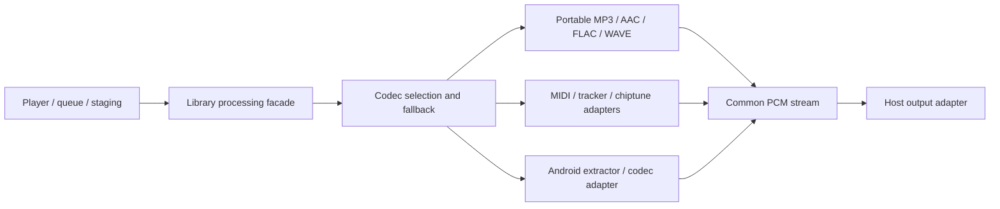

# Parsing, decoding and output boundaries

Updated 2026-10-30 for the portable codec and Android adapter increment.

`audio-api` contains contracts, models and existing playlist/CUE/CDDB parsing. `audio-core` is a JVM library containing portable implementations and `AudioFileProcessor`; it has no dependency on an Android SDK, Activity, player service, storage runtime, output device or Cast service. `audio-processing` is the Android composition and native tracker packaging module. It depends on the core, and registers Android's extractor/codec adapter inside the library.

## Input and stream contracts

`AudioInput` is reopenable and creates independent closeable `AudioBytes` random-access handles. Codecs own the handles they open. `FileAudioInput` and `MemoryAudioInput` are JVM conveniences; the host retains staging/cache leases until their streams or preparations finish.

`PcmDecoder` opens a `PcmStream` with format metadata. Reads return complete interleaved frames, left-aligned in signed 32-bit integer samples; the format records sample precision. EOF is -1. An all-zero block is valid audio. Backend objects and platform media handles do not cross the contract.

`AudioFileProcessor` selects codecs with explicit `PLATFORM_FIRST`, `PORTABLE_FIRST` or `PORTABLE_ONLY` policy. Existing specialized/composite formats keep their previous rendering priority. Standard formats can use either Android decoding or a portable implementation. A streaming open can fail during consumption and callers must close it; it cannot silently switch codecs after samples have already reached an output device.

Prepared-file decoding can recover from a later codec error: it closes the failed decoder, discards partial PCM and restarts another codec at source position zero. The destination is a host-owned staging file and must differ from the source. Cancellation closes handles and discards partial output. Successful preparation reports the selected decoder, exact PCM duration and streaming health metrics.

## Portable codecs

MP3/Layer II synthesis is translated from JLayer. Our Xing/Info/LAME reader supplies musical frame counts and encoder/synthesis delay trimming where metadata is available. AAC uses our ADTS and ISO-BMFF box/sample-table readers with JAAD synthesis. Supported edit lists trim AAC delay and padding; encrypted tracks and complex edits are rejected so another backend can handle them. FLAC's parser validates frame/header CRCs and reconstructs constant, verbatim, fixed and LPC subframes, Rice/escape residuals, wasted bits and stereo decorrelation. High-resolution FLAC is retained through 32-bit samples. WAVE PCM/float input is read in blocks.

The old `AudioProcessor.decode` returns an in-memory 16-bit `AudioPcmData` compatibility result. It uses the same backend selection inside the Android composition, including platform fallback. Streaming and prepared-file APIs preserve higher precision and do not allocate a whole track's PCM in memory. Existing MIDI/tracker/soundbank/chiptune renderers retain their buffered synthesis behavior and caps through a compatibility adapter.

## Android and player integration

`AndroidPcmDecoder` owns MediaExtractor, MediaDataSource and MediaCodec. It translates Android PCM encodings, releases the decoder on failure/close, and applies encoder delay/padding once to the resulting samples. If a platform codec reduces FLAC source precision, preparation can fall back to the portable decoder. Android metadata and position-following analysis remain separate library adapters.

InfiniFolder retains player service state, source staging and leases, output routing, focus, speed, seeking, repeat/shuffle, CUE source ranges, queue/preload/handoff, visualization presentation and Cast. Its main and preload paths now call the library to prepare PCM; MediaPlayer is given only that canonical PCM file. Duration discovery uses the library, without constructing a player to parse the source. The diagnostic facade connects per-request preparation/decode events to the existing playback report; preloading suppresses those events.

The current output path prepares a complete PCM WAVE file before playback to retain MediaPlayer's existing linked gapless players. Processing is bounded in memory, but output staging consumes disk and may increase startup/preload time. RIFF output over 4 GiB is rejected explicitly. A future host can connect `PcmStream` to streaming output without changing codec interfaces. Device gapless/interruption/route checks remain necessary; source and format tests alone cannot validate hardware playback.

## Portability

The portable API/core build and tests exclude the Android module with `-PportableOnly=true`. Linux, Windows and macOS JVM hosts can use that core and provide their own output. Native iOS/macOS integration requires common/native contracts, native codec adapters and toolchain-specific packaging; this increment does not claim those binaries exist. See the [portability roadmap](portability-roadmap.md).

## Native ownership and notices

Tracker JNI sources/build task/load names remain in `audio-processing`; the bridge's JVM class moves with the portable core and retains its JNI class name. Android consumer rules preserve the linkage. Existing Termux packaging and Kotlin fallback remain. See [codec implementations and notices](third-party.md).
